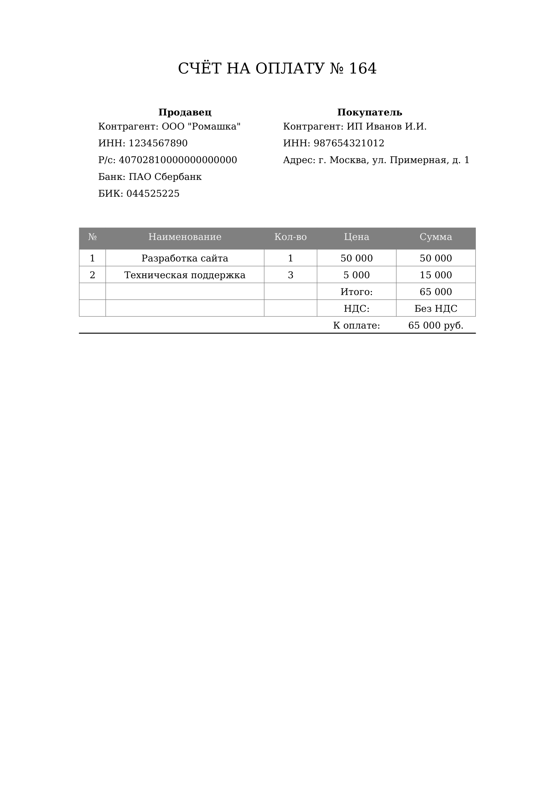

# Invoice Generator

Python-скрипт для генерации PDF-счетов на оплату с помощью ReportLab.

## Требования

- Шрифты DejaVu (`DejaVuSerif.ttf`, `DejaVuSerif-Bold.ttf`)

## Использование

1. Отредактируйте данные счёта в `main.py`:
   - Информация о продавце (`Counterparty`)
   - Информация о покупателе (`Counterparty`)
   - Позиции счёта (`ServiceItem`)
   - Итоговые суммы

2. Запустите скрипт:

   ```bash
   python -m venv .venv
   source ./venv/bin/activate
   pip install reportlab
   python main.py
   ```

3. Сгенерированный PDF будет сохранён в папку `result/` с именем файла текущей даты и времени

## Пример работы

[](.Examples/Work_example.pdf)

## Структура проекта

```
invoice-gen/
├── main.py          # Логика генерации документа
├── models.py        # Классы данных (Invoice, Counterparty, ServiceItem)
└── result/          # Папка для сгенерированных PDF
```

## Пример реализации объектов

```python
seller = Counterparty(
    name='ООО "Ромашка"',
    inn="1234567890",
    account="40702810000000000000",
    bank="ПАО Сбербанк",
    bik="044525225",
)

items = [
    ServiceItem("1", "Разработка сайта", "1", "50 000", "50 000"),
]

invoice = Invoice(
    invoice_number="164",
    date="27.03.2026",
    seller=seller,
    buyer=buyer,
    items=items,
    subtotal="65 000",
    vat="Без НДС",
    grand_total="65 000 руб.",
)
```
